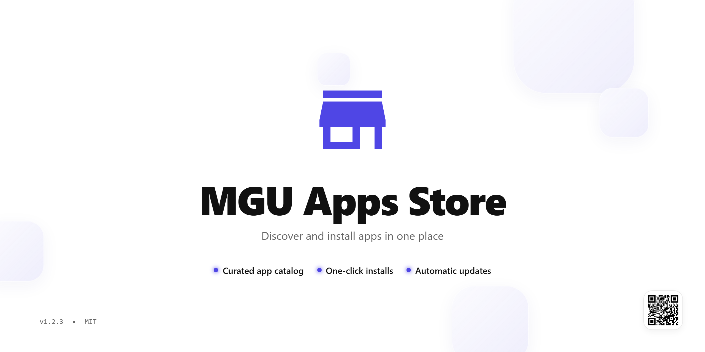

# MGU Apps Store: Unified Application Management & Discovery Platform for Windows 11

### 💻 PowerShell Installer

   

---

MGU Apps Store provides centralized catalog of native applications for centre display of BMW iDrive 7 (MGU) and iDrive 8 head units, distributed through MGU Store single installable. Once is registered, every catalogued app installs and updates directly on vehicle, with dependencies, icons, and version metadata resolved automatically. Each package ships versioned OAP archive built from its own repository, and storefront's catalog is regenerated and published on every release. result is repeatable, self-contained distribution pipeline for car software—from package validation and artwork generation to on-device deployment.

## ✅ Requirements

- Windows 10 or Windows 11
- PowerShell 5.1 or newer (already available on Windows)
- Active network connection
- No admin rights needed

## Features

**Unified integration** — register MGU Apps Store single catalog inside MGU Store. Once added, complete app catalog becomes available directly on centre display, with new entries and version updates propagating automatically to vehicle.

- **OAP package distribution** — every app is delivered self-contained `<id>@<version>.tgz` OAP package. Packages are validated at publish time, and catalog manifest is generated alongside binary, guaranteeing that what Store resolves matches what was published.

- **-vehicle installation and updates** — apps install and refresh from car itself via Store interface. No desktop-side sideloading or manual file transfer is required after is registered.

- **Declarative catalog metadata** — each entry `apps.json` declares its title, tagline, description, author, repository, target head units (`mguHmi`), runtime requirements, required Store components (`requires`), and preview image. Store renders and filters entries from this metadata alone.

- **Automated publishing pipeline** — single `tools/publish.py` invocation performs package verification, catalog generation, artifact upload to `catalog` release, card artwork rendering, and README app-list maintenance, keeping published state and documentation sync.

- **Compatibility-scoped delivery** — entries are explicitly bound to supported head units (iDrive 7 / MGU and iDrive 8), so Store only surfaces apps whose declared targets match host vehicle configuration.

- **Accessible, openly published catalog** — all apps are distributed at no cost to user and are openly listed; is maintained hobby project by iDrive Labs.

- **Telemetry and vehicle-data app support** — catalog supports apps that consume vehicle telemetry, including leaderboard-driven experiences that require network connectivity declared per entry.

- **Version pinning and release tracking** — each app resolves against its latest published release, with exact version recorded package identifier, allowing deterministic installs and straightforward rollback by version reference.

## How It Works

MGU Apps Store operates lightweight catalog layer on top of MGU Store client already present on head unit. application does not modify firmware or system partitions; it registers remote, retrieves signed catalog manifest, and hands package references to Store for resolution and installation.

** registration.** Store accepts single repository identifier. Once registered, client fetches catalog manifest from corresponding release channel and caches it locally. manifest enumerates every published application with its identifier, version, target head units, declared dependencies, and component requirements.

**Catalog resolution.** On launch, application queries cached manifest and compares each entry against installed set. Version deltas are computed per package, so only changed artifacts are surfaced for download. Dependency declarations are validated before an install is offered, preventing partial or incompatible deployments.

**Package format.** Each application is distributed an OAP archive named `<id>@<version>.tgz`. archive carries its own metadata, icon assets, and compatibility declarations. Store verifies archive integrity and target compatibility against head unit's HMI profile before proceeding.

**Install and update flow.** Selecting an entry routes package through Store's standard installation pipeline: download, verification, extraction, and registration. Updates follow same path and are offered only when manifest advertises higher version for compatible target. Removal is handled by Store and leaves no residual state catalog.

**Target gating.** Every entry declares head units it supports. application filters visible catalog against detected HMI profile, so incompatible packages are never presented for installation. This keeps interface deterministic across iDrive 7 (MGU) and iDrive 8 units.

**Publishing pipeline.** Maintainers build each application its own repository, then submit resulting archive to catalog tooling. tooling validates package, regenerates manifest, uploads artifact and its icon to release channel, and refreshes rendered catalog cards. published manifest is single of truth client consumes.

**Refresh behavior.** catalog is refreshed on demand and on periodic basis. Manifest fetches are conditional, so unchanged catalogs incur no redundant transfer. Cached entries remain usable while offline, and pending updates resume once connectivity returns.

## Compatibility

MGU Apps Store is engineered for centre-display environment of BMW **iDrive 7 (MGU)** and **iDrive 8** head units. Compatibility is determined at head-unit level rather than by vehicle model year, so any car running either of these infotainment generations can host once required platform conditions are met.

Root access on head unit is mandatory. Store operates at system level to register, resolve packages, and apply updates place, and these operations require elevated privileges that stock user interface does not expose. Without root, neither registration nor app installation can proceed.

**MGU Store** must already be present and configured on head unit, it is runtime that consumes this and manages app lifecycle. MGU Apps Store does not bundle Store or bypass it; it delivers catalog metadata, OAP packages, icons, and preview assets that Store ingests directly.

Head-unit targeting is declared per app through `mguHmi` field catalog. Each entry states iDrive generations it supports, and Store will only offer apps whose declared targets match host unit. This prevents installation of packages built for an incompatible HMI layer and keeps visible catalog aligned with actual hardware generation.

Runtime dependencies are likewise declared per app and resolved before installation. Where an app requires internet connectivity — for instance, to reach leaderboard service — this is stated its catalog entry so that requirement is visible prior to install rather than discovered at first launch.

Updates are delivered through same channel installation. When newer package version is published to catalog, Store detects it and applies update place, preserving configuration so that no manual re-registration is needed after initial setup.

## FAQ

**Which head units are supported?**
MGU Apps Store targets iDrive 7 (MGU) and iDrive 8 head units. catalog is filtered by `mguHmi` field declared for each app, so given listing only surfaces on platforms it was built for.

**What is required before Store can consume this?**
Root access on head unit and an installation of MGU Store. All runtime dependencies an app declares — including any required Store components listed its `requires` field — are resolved through Store itself; nothing additional needs to be provisioned manually.

**How does registration work?**
repository is registered inside MGU Store, pointing at `catalog` release. Once registered, catalog metadata drives listing, installation, and update delivery directly from vehicle's centre display.

**How are catalog updates and app versions delivered?**
Each app is packaged an OAP archive named `<id>@<version>.tgz`. On publish, catalog (`catalog.json`), package, and icon are uploaded to `catalog` release; Store reads that catalog to detect new versions and serves updates place. Version strings follow semantic versioning declared by each app repository.

**Is internet connectivity mandatory?**
Connectivity is required only for features that depend on remote services — for example, leaderboard synchronization Sideways. Core catalog browsing and update checks operate against configured; individual app entries document their own network requirements.

**What does each catalog entry contain?**
Every listing declares title, tagline, description, author, repository, target head units (`mguHmi`), runtime requirements, required Store components (`requires`), and preview image stored under `previews/`. This metadata is what Store renders and what install resolution is based on.

**How is new version published to catalog?**
Build app into an OAP package its own repository, then run publish tool against archive with an icon path. tool validates package, regenerates `catalog.json`, uploads artifacts to `catalog` release, and refreshes catalog cards and app listing.

**Are these official BMW applications?**
No. apps are unofficial, independently developed, and neither affiliated with nor endorsed by BMW AG. Compatibility is scoped to head units and Store components explicitly declared each catalog entry.

## Disclaimer

MGU Apps Store is an independent, community-driven catalog of applications for BMW iDrive 7 (MGU) and iDrive 8 head units, distributed OAP packages through MGU Store mechanism. It is an unofficial project and is not affiliated with, endorsed by, sponsored by, or any way associated with BMW AG or any of its subsidiaries or partners. All trademarks, product names, and branding referenced remain property of their respective owners and are used solely for identification and compatibility purposes.

All applications published through this are provided " is" and " available," without warranties of any kind, whether express, implied, or statutory, including but not limited to warranties of merchantability, fitness for particular purpose, and non-infringement of third-party rights. maintainers make no representations regarding accuracy, reliability, completeness, or suitability of any application, catalog entry, or accompanying metadata for any particular use case or vehicle configuration.

Installation and operation of any application this catalog require compatible head unit with root access and MGU Store runtime present. Users assume full responsibility for verifying compatibility with their specific vehicle, software version, and hardware revision prior to installation, and for ensuring that all modifications comply with applicable local laws, regulations, and vehicle warranty terms. Modifying vehicle head unit software may affect safety systems, diagnostic behavior, or manufacturer support eligibility; such consequences are entirely responsibility of user.

maintainers, contributors, and authors of individual applications shall not be liable for any direct, indirect, incidental, special, consequential, or punitive damages arising from use, misuse, or inability to use any application or this, including but not limited to data loss, vehicle malfunction, service disruption, or costs associated with recovery or repair, even if advised of possibility of such damages.

MGU Apps Store functions strictly distribution catalog: each application is developed and maintained independently its own repository, and its respective author bears sole responsibility for that application's behavior, content, and compliance. Publication within this does not constitute an audit, certification, or endorsement of any application's safety, security, or quality. Users are encouraged to review each application's documentation and repository before installation.

maintainers reserve right to modify, suspend, or discontinue this, any catalog entry, or any associated distribution channel at any time without prior notice. Continued use of after any revision constitutes acceptance of then-current terms. If any provision of this disclaimer is held unenforceable, remaining provisions shall remain full force and effect.

## License

MGU Apps Store is distributed under MIT License, permissive, OSI-approved license that grants unrestricted use, modification, and redistribution of software, subject to inclusion of original copyright notice and permission notice all copies or substantial portions of software. license imposes no restrictions on commercial or private deployment, and does not require derivative works to be released under same terms.

software is provided " is", without warranty of any kind, express or implied, including but not limited to warranties of merchantability, fitness for particular purpose, and noninfringement. no event shall authors or copyright holders be liable for any claim, damages, or other liability, whether an action of contract, tort, or otherwise, arising from, out of, or connection with software or use or other dealings software.

MGU Apps Store is an independent, community-driven project and is not affiliated with, endorsed by, or sponsored by BMW AG. All trademarks and product names referenced remain property of their respective owners. Use of software is at user's sole discretion and risk, and users are responsible for ensuring compliance with any applicable terms governing their vehicle's head unit and installed software.